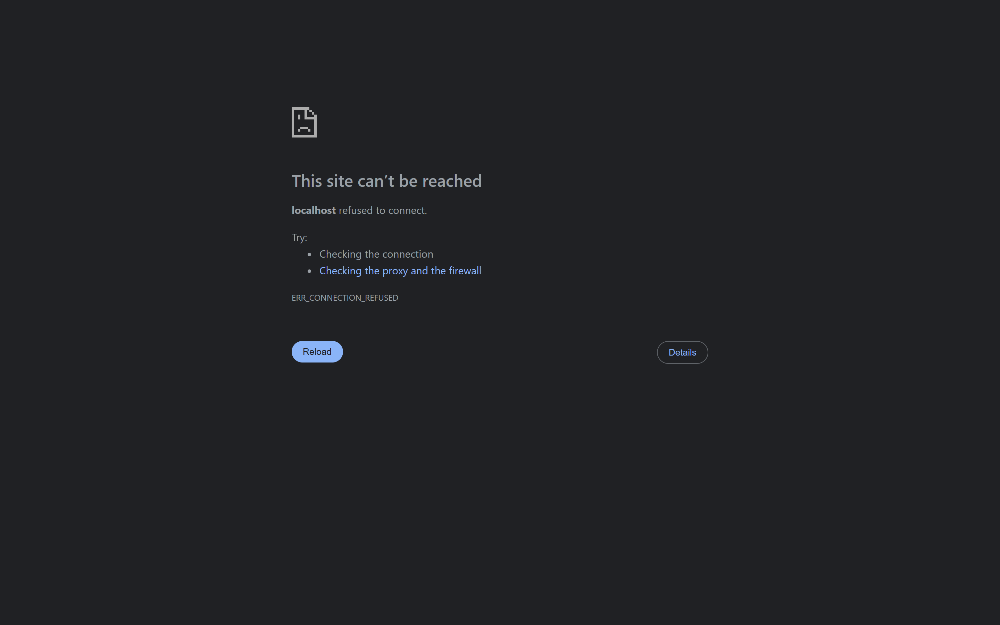
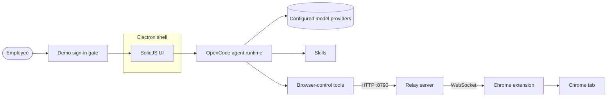
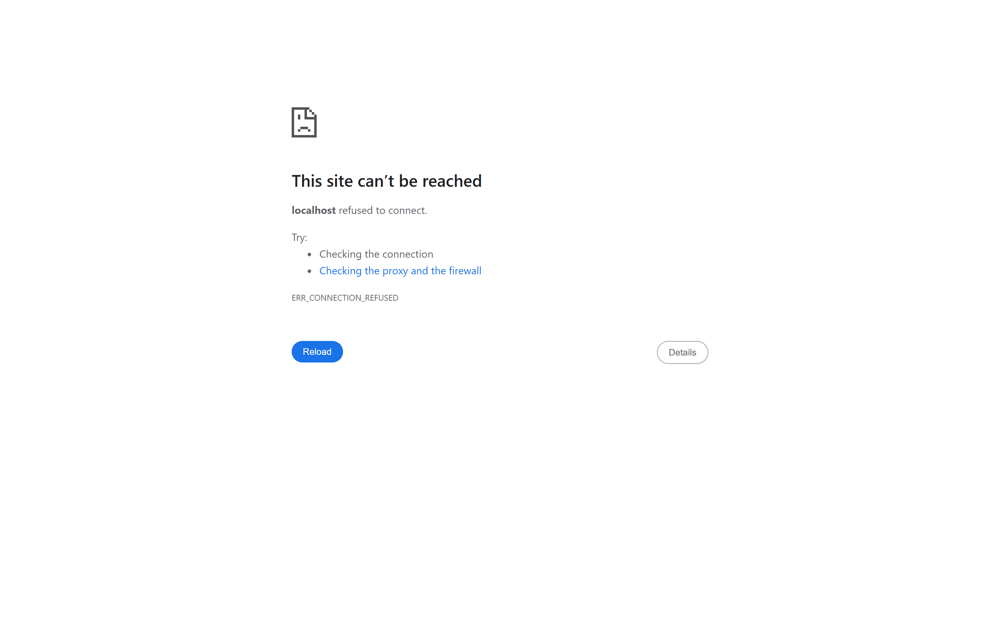
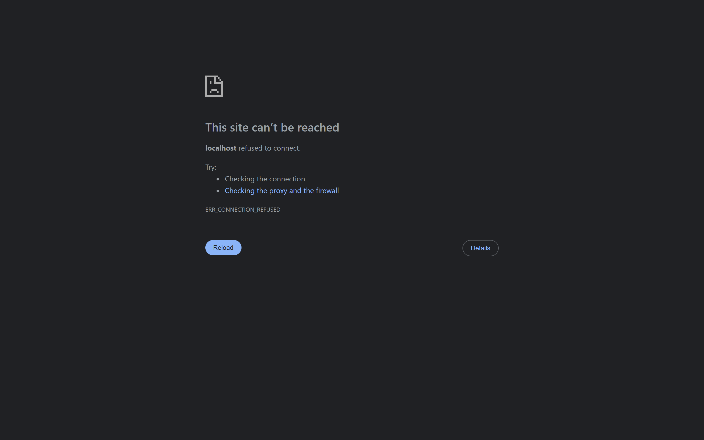
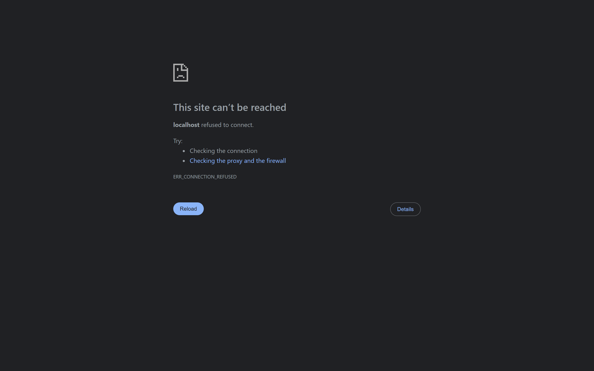
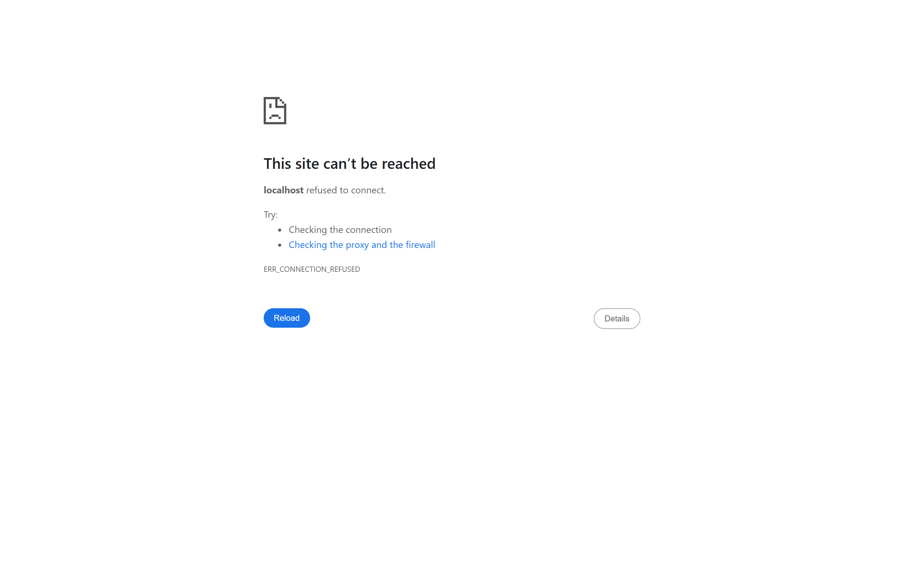

<div align="center">


# MINTHU

**A private, company-style desktop AI assistant, built by customizing the open-source OpenCode agent.**




</div>

> This repo holds **only my additions** plus one patch for my edits to upstream files.
> The base is [OpenCode](https://github.com/anomalyco/opencode) (MIT). It is not a full fork.

---

## Table of contents

- [Motivation](#motivation)
- [Features](#features)
- [Architecture](#architecture)
- [Project structure](#project-structure)
- [Technical highlights](#technical-highlights)
- [Getting started](#getting-started)
- [Screenshots](#screenshots)
- [Roadmap](#roadmap)
- [License](#license)

---

## Motivation

- Companies want AI agents, but not their work flowing through public services.
- Teams repeat the same prompts and procedures.
- Generic tools don't feel like *the company's* tool.

**Goal:** a private-by-default agent with company sign-in and shareable know-how.

---

## Features

| Feature | What it does |
| --- | --- |
| **Private by default** | Auto-update, session sharing, models catalog, changelog fetch, hosted web UI proxy and language-server downloads are off. |
| **Company sign-in (demo)** | Username, password and department. Nothing is verified; the password is never stored. |
| **User chip + sign out** | Shows name and department; sign out returns to the sign-in screen. |
| **Browser control** *(experimental)* | Chrome extension + local relay + 20+ tools so the agent can navigate, read, click, fill and screenshot. |
| **`disableStream` option** | Makes OpenAI-compatible endpoints that can't stream work with this agent. |
| **Proposal-deck skill** | Turns a rough idea into a 9-slide `.pptx` with speaker notes. |
| **Isolated identity** | Own name, icons, app ID and data folder, separate from any installed OpenCode. |
| **Windows local build** | Unsigned unpacked build for dev machines; signed installer only in CI. |

---

## Architecture



- The sign-in gate wraps the app; it runs before any server connection.
- Browser control is a separate process pair (relay + extension).
- Upstream network features are switched off by flags and small edits.

---

## Project structure

```text
.
├── browser-control/        # Chrome extension, relay server, agent tools
│   ├── extension/          #   MV3 service worker (the "hands")
│   ├── server/             #   Bun relay on port 8790
│   └── tools/              #   one file per agent tool
├── src/                    # New source files, at their OpenCode paths
│   └── packages/
│       ├── app/            #   demo sign-in screen + session logic + tests
│       └── opencode/       #   disableStream provider wrapper + tests
├── patches/                # My edits to upstream files, as one patch
├── skills/                 # Proposal-deck skill (third-party, MIT)
├── scripts/gen-icons.py    # Builds the icon set from one image
└── docs/                   # Screenshots, logo, full project brief
```

---

## Technical highlights

- **Small surface area:** the sign-in gate touches upstream with 3 lines in `app.tsx`; everything else is new files.
- **Typed, tested logic:** session code and `disableStream` are pure modules with unit tests (no `any`, schema-parsed JSON).
- **Stream shim:** `disableStream` sends `stream: false`, then replays the reply as one SSE `chat.completion.chunk` so the SDK's parser stays happy. Upstream errors pass through untouched.
- **Safe storage:** only username and department are saved; the password never is.
- **Offline-first defaults:** flags flip upstream features from opt-out to opt-in.
- **Reviewable customization:** one patch file shows every upstream edit.

---

## Getting started

Needs [Bun](https://bun.sh) and Git. This repo applies *on top of* OpenCode:

```bash
git clone https://github.com/anomalyco/opencode.git
cd opencode
git checkout 03e67171ab                       # the commit this was built on
git apply /path/to/this-repo/patches/minthu-customizations.patch
cp -r /path/to/this-repo/src/packages/. packages/
cp -r /path/to/this-repo/browser-control .
cp -r /path/to/this-repo/skills/project-proposal-slides .opencode/skills/
bun install
bun dev:desktop
```

Run the tests from inside the package directory:

```bash
cd packages/opencode && bun test test/provider/disable-stream.test.ts
cd packages/app && bun test --conditions=solid --preload ./happydom.ts src/utils/demo-session.test.ts
```

Browser control (experimental): run `bun run start` in `browser-control/server`, then load
`browser-control/extension` as an unpacked extension in Chrome.

Turn the sign-in screen off with `VITE_DEMO_LOGIN=false`.

---

## Screenshots

Captured from the web build with fake data (demo user "Aye Chan", Engineering). The debug
bar from the dev build was painted over.

| | |
| :---: | :---: |
|  |  |
| Sign-in (dark) | Sign-in (light) |
|  |  |
| Validation error | Signed in (dark) |
|  | |
| Signed in (light) | |

---

## Roadmap

- [ ] **Secure browser control**: localhost-only bind, shared secret, origin check
- [ ] **Skills library**: per-person skills shared to department or company, called with `/`
- [ ] **Approval layer**: domain allowlist, confirm before submit or delete, action log
- [ ] Department-aware defaults tied to sign-in
- [ ] Local model setup (Ollama, LM Studio)
- [ ] Demo GIF

Known limits: the sign-in is a demo, not security; browser control has no authentication yet.
Full spec in [`docs/PROJECT-BRIEF.md`](docs/PROJECT-BRIEF.md).

---

## License

MIT. Based on [OpenCode](https://github.com/anomalyco/opencode), copyright its contributors;
see [`LICENSE`](LICENSE). The proposal-deck skill keeps its original authors' credit in
`skills/project-proposal-slides/SKILL.md`.
