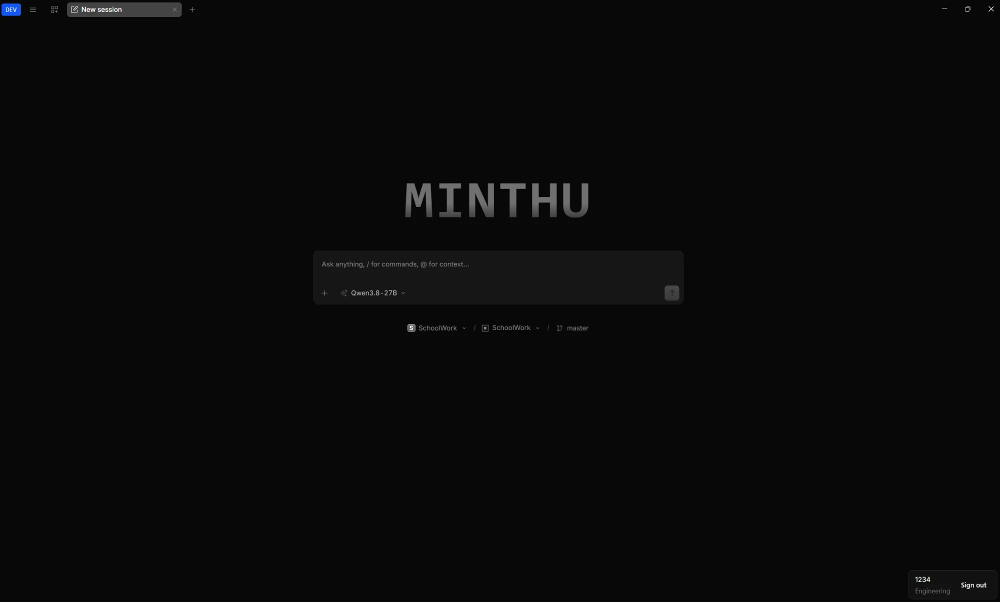
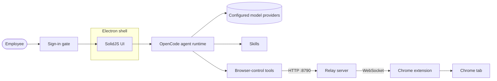
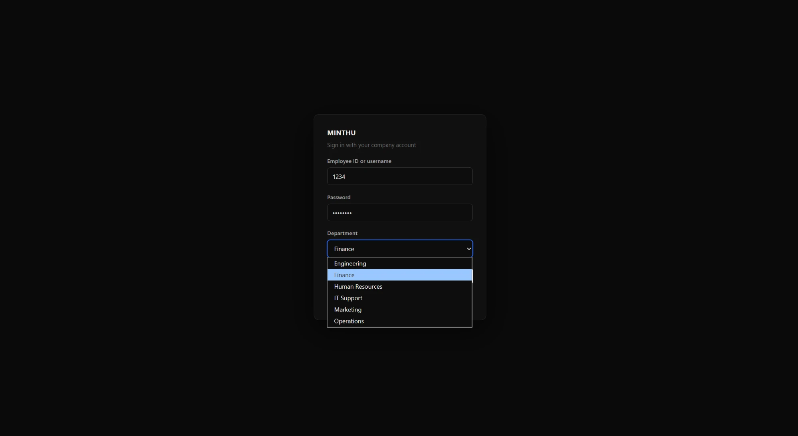
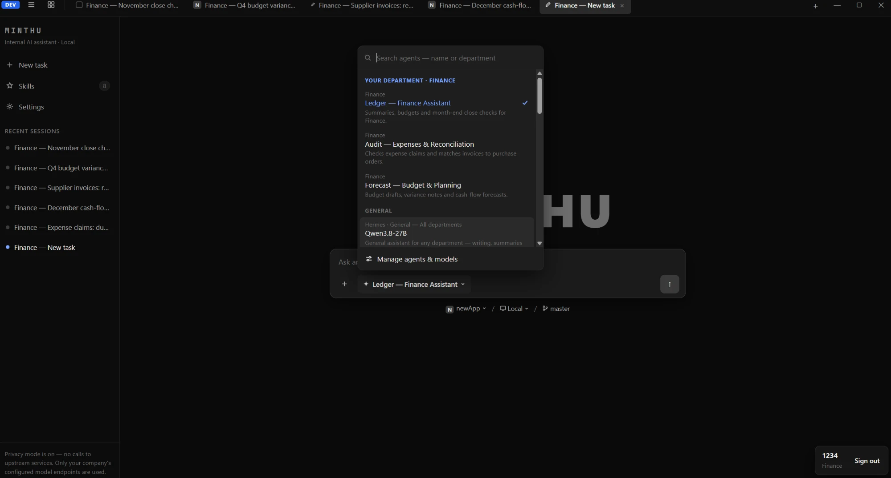
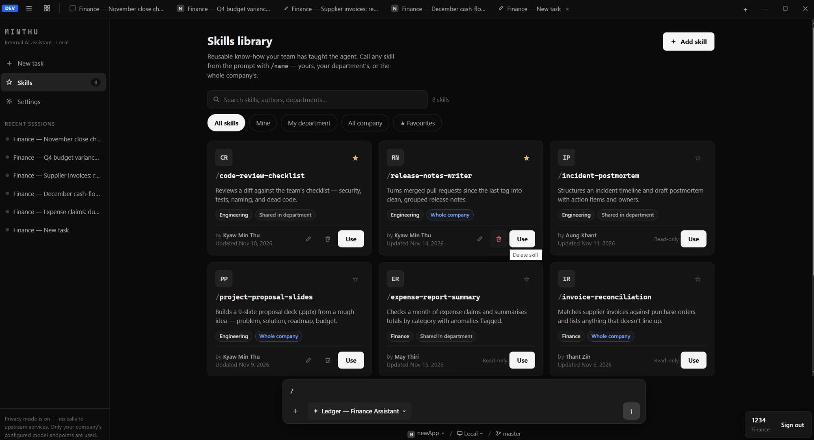
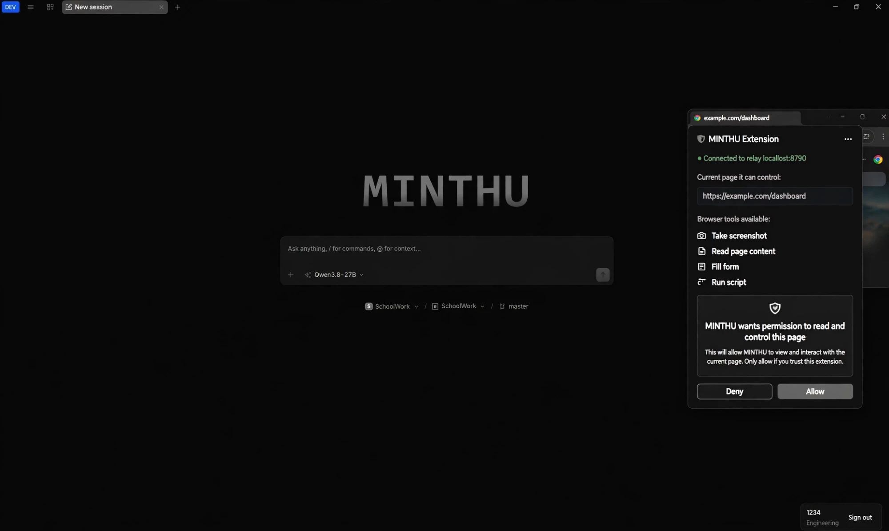

<div align="center">


# MINTHU

**OpenCode, rebuilt for company use: private by default, signed-in by department, with shared skills and browser control.**




</div>

> This repo holds **only my additions** plus one patch for my edits to upstream files.
> The base is [OpenCode](https://github.com/anomalyco/opencode) (MIT). It is not a full fork.
>
> † marks features shown in the screenshots whose source is **not in this repo yet**.

---

## MINTHU vs OpenCode

**Same agent core. Different defaults, identity, and reach.**

| | OpenCode (base) | MINTHU |
| --- | --- | --- |
| **Network by default** | Update checks, session sharing, model catalog fetch, changelog fetch, web UI proxy, language-server downloads are on | **All off.** Opt back in per feature with flags. The sidebar says so: "Privacy mode is on"† |
| **Who is using it** | Anonymous single user | **Company sign-in** with department, user chip, sign out |
| **Agents** | Not in the repo | **Department-aware agent picker**†: your department first, then general agents |
| **Skills** | Loaded from folders; no shared library screen | **Skills library**†: per person, department or company; call with `/name`; edit or delete your own |
| **Models** | Built-in catalog of providers | **You choose.** Only providers you configure appear |
| **Endpoints that can't stream** | No option to turn streaming off | **`disableStream` option** replays a normal reply as a stream |
| **Browser** | Not in the repo | **Real-Chrome control** (experimental), with an Allow / Deny prompt before a page is controlled† |
| **Install identity** | Shares app ID and data folder with every OpenCode install | **Own name, icons, app ID, data folder.** Runs side by side |

**What that buys a company**
- Work goes only to the model endpoints it configures.
- Every session starts with a known user and department.
- Know-how stops living in people's heads: it becomes skills anyone can call.
- One patch file shows exactly what changed, so security review is quick.

**Where it is *not* better**
- Same agent engine, tools, and model support as OpenCode. It does not add capability there.
- No built-in model list, so setup is manual.
- The sign-in screen does not verify credentials, and the browser-control code in this repo has no authentication yet.

---

## Table of contents

- [MINTHU vs OpenCode](#minthu-vs-opencode)
- [Motivation](#motivation)
- [Features](#features)
- [Architecture](#architecture)
- [Project structure](#project-structure)
- [Technical highlights](#technical-highlights)
- [Getting started](#getting-started)
- [Screenshots](#screenshots)
- [Roadmap](#roadmap)
- [License](#license)

---

## Motivation

- Companies want AI agents, but not their work flowing through public services.
- Teams repeat the same prompts and procedures.
- Generic tools don't feel like *the company's* tool.

**Goal:** a private-by-default agent with company sign-in and shareable know-how.

---

## Features

| Feature | What it does |
| --- | --- |
| **Private by default** | Auto-update, session sharing, models catalog, changelog fetch, hosted web UI proxy and language-server downloads are off. |
| **Company sign-in** | Username, password and department (Engineering, Finance, Human Resources, IT Support, Marketing, Operations). Credentials are not verified; the password is never stored. |
| **User chip + sign out** | Shows name and department; sign out returns to the sign-in screen. |
| **Department agents** † | Agent picker that lists your department's agents first, then general ones, with search by name or department. |
| **Skills library** † | Browse, search and filter skills (All, Mine, My department, All company, Favourites). Add a skill, mark favourites, edit or delete your own, read others', and press **Use** to call one. |
| **Browser control** *(experimental)* | Chrome extension + local relay + 20+ tools so the agent can navigate, read, click, fill and screenshot. Shows an Allow / Deny prompt before controlling a page.† |
| **`disableStream` option** | Makes OpenAI-compatible endpoints that can't stream work with this agent. |
| **Isolated identity** | Own name, icons, app ID and data folder, separate from any installed OpenCode. |
| **Windows local build** | Unsigned unpacked build for dev machines; signed installer only in CI. |

† Shown in the screenshots; source not in this repo yet.

---

## Architecture



- The sign-in gate wraps the app; it runs before any server connection.
- Browser control is a separate process pair (relay + extension).
- Upstream network features are switched off by flags and small edits.

---

## Project structure

```text
.
├── browser-control/        # Chrome extension, relay server, agent tools
│   ├── extension/          #   MV3 service worker (the "hands")
│   ├── server/             #   Bun relay on port 8790
│   └── tools/              #   one file per agent tool
├── src/                    # New source files, at their OpenCode paths
│   └── packages/
│       ├── app/            #   sign-in gate + session logic + tests
│       └── opencode/       #   disableStream provider wrapper + tests
├── patches/                # My edits to upstream files, as one patch
├── scripts/gen-icons.py    # Builds the icon set from one image
└── docs/                   # Screenshots, logo, full project brief
```

---

## Technical highlights

- **Small surface area:** the sign-in gate touches upstream with 3 lines in `app.tsx`; everything else is new files.
- **Typed, tested logic:** session code and `disableStream` are pure modules with unit tests (no `any`, schema-parsed JSON).
- **Stream shim:** `disableStream` sends `stream: false`, then replays the reply as one SSE `chat.completion.chunk` so the SDK's parser stays happy. Upstream errors pass through untouched.
- **Safe storage:** only username and department are saved; the password never is.
- **Offline-first defaults:** flags flip upstream features from opt-out to opt-in.
- **Reviewable customization:** one patch file shows every upstream edit.

---

## Getting started

Needs [Bun](https://bun.sh) and Git. This repo applies *on top of* OpenCode:

```bash
git clone https://github.com/anomalyco/opencode.git
cd opencode
git checkout 03e67171ab                       # the commit this was built on
git apply /path/to/this-repo/patches/minthu-customizations.patch
cp -r /path/to/this-repo/src/packages/. packages/
cp -r /path/to/this-repo/browser-control .
bun install
bun dev:desktop
```

This gives you the privacy defaults, sign-in gate, `disableStream` and browser-control code.
The agent picker, skills library and permission prompt (†) are not included yet, and the
sign-in layout in `src/` is simpler than the one in the first screenshot.

Run the tests from inside the package directory:

```bash
cd packages/opencode && bun test test/provider/disable-stream.test.ts
cd packages/app && bun test --conditions=solid --preload ./happydom.ts src/utils/login-session.test.ts
```

Browser control (experimental): run `bun run start` in `browser-control/server`, then load
`browser-control/extension` as an unpacked extension in Chrome.

Turn the sign-in screen off with `VITE_LOGIN_SCREEN=false`.

---

## Screenshots

From the full MINTHU build, with sample people and data. Screens 3 to 5 show the † features.

| | |
| :---: | :---: |
|  |  |
| **1. Sign-in.** Employee ID, password, and a department list (Engineering, Finance, Human Resources, IT Support, Marketing, Operations) | **2. Home.** Prompt box ("/ for commands, @ for context"), model picker, project and branch, signed-in user chip |
|  |  |
| **3. Department agents.** Search by name or department; Finance agents first, general agents below; sidebar shows Skills, recent sessions and "Privacy mode is on" | **4. Skills library.** Filters, favourites, department and sharing labels, author, Use button, edit and delete on your own skills, read-only on others' |
|  | |
| **5. Browser control.** The extension shows the connected relay, the page it can control, its tools (screenshot, read page, fill form, run script), and Allow / Deny | |

---

## Roadmap

- [ ] Publish the source for the agent picker, skills library and permission prompt (†)
- [ ] **Secure browser control**: localhost-only bind, shared secret, origin check
- [ ] Domain allowlist and an action log for browser control
- [ ] Department-aware defaults tied to sign-in
- [ ] Local model setup (Ollama, LM Studio)
- [ ] Animated preview (GIF)

Known limits: the sign-in does not verify credentials; the browser-control code in this repo has
no authentication yet. Full spec in [`docs/PROJECT-BRIEF.md`](docs/PROJECT-BRIEF.md).

---

## License

MIT. Based on [OpenCode](https://github.com/anomalyco/opencode), copyright its contributors;
see [`LICENSE`](LICENSE).
